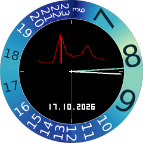
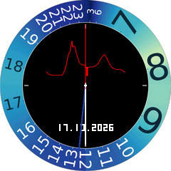
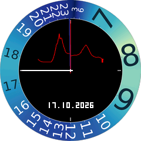

# Nonlinear Clock

Eine 24-Stunden-Uhr mit ungleichmäßiger Stundenskala: In Tagesphasen mit vielen gewichteten Verkehrsereignissen legt der Stundenzeiger mehr Winkel zurück. Hardware: **Waveshare RP2040-LCD-1.28**, 240 × 240 Pixel.

Die Abbildungen sind mit dem Firmware-Renderer erzeugte Vorschauen, keine Gerätefotos.

**Idee, Anforderungen und gestalterische Entscheidungen: pgreendale.** Das Projekt wurde im Dialog fast vollständig von **ChatGPT Codex** erstellt: Recherche, Modellierung, Gestaltungsausarbeitung, Firmware, Werkzeuge und Dokumentation. pgreendale gab die Richtung vor und prüfte die Darstellung am Gerät. Fremdcode und Datenquellen sind gesondert ausgewiesen.

## Dokumentation

1. [Vorarbeit – Daten, Gewichtung und Winkelgeschwindigkeit](docs/01-vorarbeit.md)
2. [Gestaltung – Ziffernblatt und Anzeige](docs/02-gestaltung.md)
3. [Umsetzung – Hardware, Schaltpläne und Bauanleitung](docs/03-umsetzung.md)
4. [Quellen und genaue Verwendung](docs/04-quellen.md)
5. [Nachweise und Prüfungen](docs/05-nachweise.md)
6. [Lizenzprüfung: MIT, Fremdrechte und offene Fragen](docs/06-lizenzpruefung.md)

**Aussagegrenze:** HETUS-Tagebuchfolgen wurden nicht ausgewertet. Das Modell kombiniert Londoner Stationsereignisse mit englischen Fahrtzweckanteilen. Es ist keine repräsentative Messung aller Tätigkeitswechsel europäischer Erwerbstätiger.

## Schnellstart

Voraussetzung: VS Code, Raspberry Pi Pico Extension mit installierten SDK-/Toolchain-Werkzeugen, Python 3.10 oder neuer im PATH. Diesen Ordner direkt als Repository-Wurzel öffnen.

    python tools/configure.py
    python tools/build.py

Windows-Alternative:

    powershell -NoProfile -ExecutionPolicy Bypass -File tools/configure.ps1
    powershell -NoProfile -ExecutionPolicy Bypass -File tools/build.ps1

Ergebnis: dist/nonlinear_clock_rp2040.uf2. BOOTSEL gedrückt halten, USB verbinden und UF2 auf RPI-RP2 kopieren. Bei nicht gefundenen Werkzeugen die [Pfadparameter](docs/03-umsetzung.md) verwenden.

    python -m pip install -r tools/requirements.txt
    python tools/sync_clock.py --list
    python tools/sync_clock.py --port COM3 --brightness 6

| Ordner | Inhalt |
|---|---|
| firmware/ | C-Firmware, Bitmap und generierte Flashdaten |
| tools/ | Konfiguration, Build, USB-Synchronisierung, Tests |
| analysis/ | abgeleitete Daten, Eingabeprüfsummen, Auswertung und Modell |
| docs/ | Dokumentation, Abbildungen und Nachweise |
| licenses/ | Lizenztext übernommener Bestandteile |
| .vscode/ | Erweiterungsempfehlungen und Buildtasks |

## Lizenzstatus

[LICENSE.md](LICENSE.md). Externes Material behält seine eigenen Bedingungen; siehe [Attributionen](THIRD_PARTY_NOTICES.md) und [Lizenzprüfung](docs/06-lizenzpruefung.md). Herkunft, Drittbedingungen und dokumentierte Quellenunsicherheiten sind im Lizenzbericht ausgewiesen.
