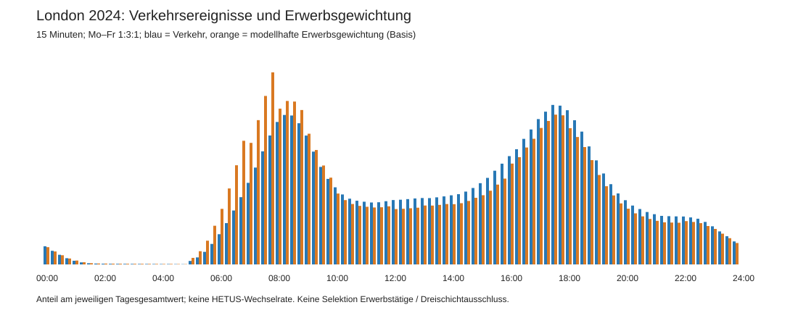
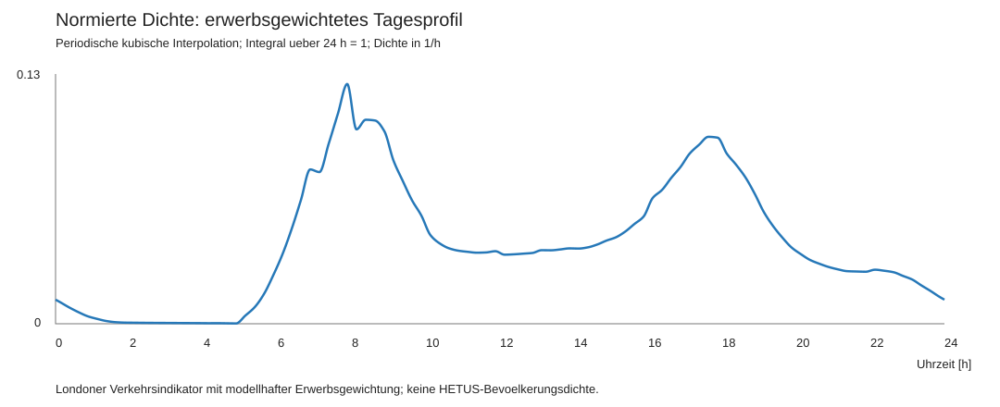
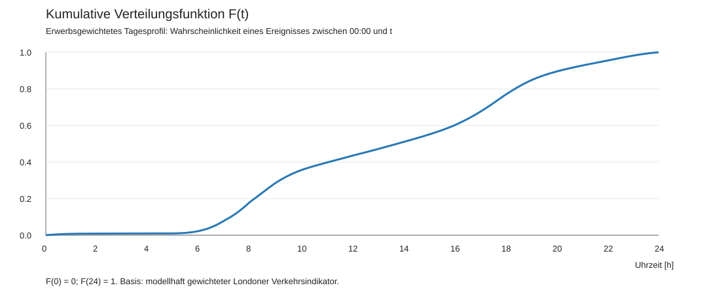
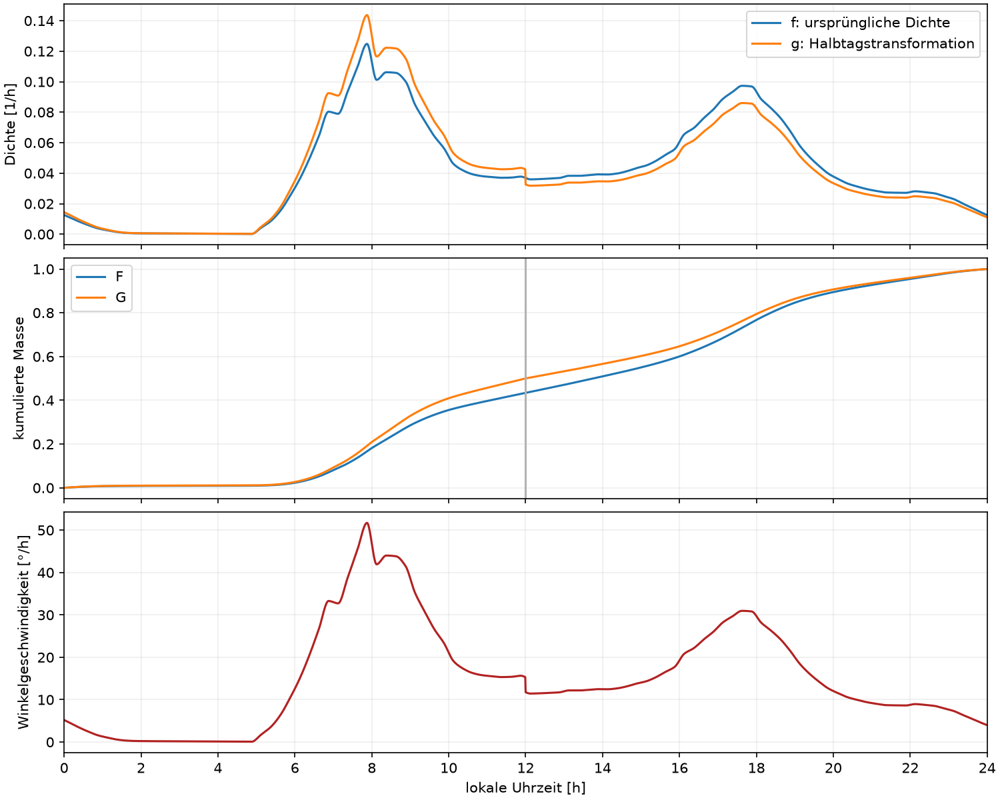

# Vorarbeit

[Übersicht](../README.md) · [Gestaltung →](02-gestaltung.md)

## Fragestellung und Grenzen

pgreendale wollte die zeitliche Dichte von Tätigkeitswechseln an Arbeitstagen Mo–Fr in Europa im 15-Minuten-Raster darstellen. Für den Unterhaltserwerb wichtige Übergänge sollten zusätzlich zählen: Eine verpasste Verbindung auf dem Arbeitsweg kann verbindliche Arbeitszeiten gefährden.

Ideal wären vollständige Tagebuchfolgen mit Erwerbsstatus und Schichtmerkmalen. Eurostat beschreibt HETUS-Tagebücher in 10-Minuten-Schritten und Scientific Use Files für 17 Länder der Welle 2010. Diese Mikrodaten lagen dem Projekt **nicht** vor. Die Recherche der Methodik ist keine Tagebuchauswertung. Erwerbstätige ohne Dreischichtbetrieb konnten nicht als eigene Teilpopulation ausgewählt werden. [HETUS-Quelle](04-quellen.md#eurostat-hetus).

Öffentliche Londoner Stationsdaten dienen deshalb als Proxy für Übergänge. Sie enthalten auch Freizeitverkehr und nicht Erwerbstätige. England/London liegt geografisch in Europa, repräsentiert aber nicht Europa insgesamt. Wenig Verkehr beweist weder Schlaf noch wenige Tätigkeitswechsel zu Hause.

## Empirisches Viertelstundenprofil

Die TfL-Dateien NUMBAT 2024 MON, TWT und FRI beschreiben typische Montage, Dienstage bis Donnerstage und Freitage. Verwendet werden Station_Entries und Station_Exits, in den gespeicherten Dateien Blatt 7 und 8. Nach drei Kopfzeilen werden numerische Stationswerte je Viertelstundenspalte L bis DC summiert. Spalte E ist die Tageskontrolle. Diese Struktur ist versionsgebunden; analysis/sources.json identifiziert die konkreten Dateien per SHA-256.

Für Intervall j:

$$
E_j=(E_{j,\mathrm{MON}}+3E_{j,\mathrm{TWT}}+E_{j,\mathrm{FRI}})/5,
$$
$$
X_j=(X_{j,\mathrm{MON}}+3X_{j,\mathrm{TWT}}+X_{j,\mathrm{FRI}})/5,
\qquad n_j=E_j+X_j.
$$

Die 96 Intervalle laufen ursprünglich von 05:00 bis 04:59 und werden auf 00–24 Uhr sortiert. Die Nachtstunden bleiben dabei dem vorangehenden Verkehrs-Betriebstag zugeordnet. Dies ist keine exakte Kalender-Mo–Fr-Rekonstruktion an den Wochenrändern.

Die Tagesmenge beträgt rund **9.861.999 Stationsereignisse**. Ein- und Ausstieg derselben Fahrt sind zwei Ereignisse; es sind weder eindeutige Personen noch eindeutige Fahrten. Stationsinterne Umstiege sind nicht vollständig erfasst. NUMBAT ist ein Modell typischer Verkehrsnachfrage, keine individuelle Tätigkeitschronik.

## Gewichtung nach Erwerbsbezug

DfT NTS0502a liefert für England 2024 stündliche Anteile der Zwecke Commuting und Business an allen Fahrtstarts Mo–Fr. Verwendet werden das Blatt NTS0502a_start_time_by_purpose, die Zeilen für 2024 ohne All day und die beiden Zweckspalten. Der Stundenanteil gilt jeweils für vier Viertelstunden.

Seien c_h und b_h diese Anteile als Zahlen von 0 bis 1:

$$
s_j=n_j[1+(w_c(h)-1)c_h+(w_b-1)b_h],\qquad
p_j=s_j/\sum_k s_k.
$$

Im Grundmodell gilt w_c=3 von 05:00 bis vor 12:00 und sonst 1,5; w_b=3, übrige Zwecke erhalten Gewicht 1. Die Faktoren sind **gesetzte Wichtigkeitsannahmen**, keine gemessenen Verspätungskosten. Die Übertragung englischer Anteile aller Verkehrsarten auf Londoner Bahnereignisse ist ebenfalls eine Modellannahme. Die Richtung einzelner Fahrten ist nicht bekannt; ein stärkerer morgendlicher Hinweg zur Arbeit wird unterstellt. Stundenweise Anteile können künstliche Stundengrenzen erzeugen.

Eine Sensitivitätsrechnung nutzt morgens Pendeln ×5, sonst ×2 und Business ×5. Rohdaten-Proxy und beide Gewichtungen stehen in profile_15min.json.

| Phase | Rohprofil | Grundmodell |
|---|---:|---:|
| 00–05 Uhr | ca. 1,00 % | ca. 0,98 % |
| 06–09 Uhr | 19,41 % | 26,26 % |
| 12–14 Uhr | 8,58 % | 7,50 % |
| 16–19 Uhr | 26,79 % | 24,60 % |

Rohmaximum: 17:30–17:45 mit 2,590 % des Tages. Gewichtetes Maximum: 07:45–08:00 mit 3,119 %. Die starke Variante verschiebt 30,76 % nach 06–09 Uhr und zeigt damit den Einfluss der subjektiven Faktoren.

## Von Intervallmassen zur Dichte

Mit h=0,25 h und Intervallmitten t_j=0,125+0,25j werden y_j=p_j/h als Dichtestützstellen gesetzt. Periodische, formerhaltende kubische Hermite-Interpolation vermeidet negative Dichten.

Für δ_j=(y_(j+1)−y_j)/h ist die Knotenableitung m_j null, wenn benachbarte Sekanten verschiedene Vorzeichen haben oder eine null ist; sonst gilt das harmonische Mittel m_j=2δ_(j−1)δ_j/(δ_(j−1)+δ_j). Indizes werden zyklisch behandelt.

Mit u=(t−t_j)/h:

$$q_j(u)=a_j+b_ju+c_ju^2+d_ju^3,$$
$$a_j=y_j,\quad b_j=hm_j,$$
$$c_j=3(y_{j+1}-y_j)-h(2m_j+m_{j+1}),$$
$$d_j=2(y_j-y_{j+1})+h(m_j+m_{j+1}).$$

Die analytische Normierung und Integration ergeben:

$$Z=\sum_j h(a_j+b_j/2+c_j/3+d_j/4),$$
$$f(t)=q_j(u)/Z,\quad F(t)=\int_0^t f(\tau)\,d\tau.$$

f ist nichtnegativ, periodisch C¹ und integriert über 24 h zu 1; die Einheit ist 1/h. F(0)=0 und F(24)=1. F beschreibt die kumulierte Masse gewichteter Proxyereignisse, keine individuelle Wechselwahrscheinlichkeit.

Die Interpolation setzt Intervallmittel an die Mitten. Sie bewahrt die einzelnen Viertelstundenmassen nicht exakt. Nachträgliche Integration kann sie geringfügig verändern. Die glatte Darstellung und die sekundengenaue Uhr erhöhen nicht die empirische Zeitauflösung der Daten.

Diese Abbildungen zeigen f und F vor der folgenden Halbtagstransformation.

## Ziffernblattaufteilung und Winkelgeschwindigkeit

Die direkte Abbildung α=2πF würde 12 Uhr nicht nach unten setzen:

$$M=F(12)=0{,}43429507228196335.$$

Für die vertrauten Positionen 0 Uhr oben, 12 Uhr unten und 24 Uhr wieder oben wird jede Hälfte separat skaliert:

$$
G(t)=
\begin{cases}
F(t)/(2M),&0\le t\le12,\\
1/2+[F(t)-M]/[2(1-M)],&12<t\le24.
\end{cases}
$$

$$
g(t)=G'(t)=
\begin{cases}
f(t)/(2M),&0\le t<12,\\
f(t)/[2(1-M)],&12\le t<24.
\end{cases}
$$

g integriert pro Halbtag zu 1/2 und über 24 h zu 1. Die bedingten Halbtagdichten f/M beziehungsweise f/(1−M) integrieren jeweils zu 1; für die globale Funktion werden sie halbiert. Die empirisch modellierte Masse 43,43 : 56,57 wird bewusst auf 50 : 50 geändert.

$$
\alpha(t)=2\pi G(t),\qquad
\omega(t)=d\alpha/dt=2\pi g(t)\quad[\mathrm{rad/h}].
$$

Für rad/s wird durch 3600 geteilt. Ein Stundenabschnitt erhält genau den Winkel 2π mal seinem Integral von g. Mehr Dichte bedeutet mehr Platz auf dem Ring und höhere Zeigergeschwindigkeit.

Bildschirmkoordinaten, y nach unten:

$$x=c+r\sin\alpha,\qquad y=c-r\cos\alpha.$$

Die Winkelposition ist stetig und monoton. Ihre Ableitung kann bei 12 Uhr und am Tagesübergang springen, weil beide Halbtagsskalierungen unterschiedlich sind.

Das Ergebnis ist eine dateninformierte Gestaltung, keine validierte europäische Norm. Frühstück, Körperpflege, häusliche Tätigkeiten oder tatsächliche Mittagspausen werden nicht direkt gemessen.
