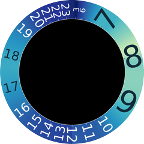

# Gestaltung

[← Vorarbeit](01-vorarbeit.md) · [Umsetzung →](03-umsetzung.md)

## Lesbarkeit und Vertrautheit

pgreendale verbindet eine ungleichmäßige 24-Stunden-Skala mit einem gewöhnlichen Minutenkreis. Eine Halbtagsteilung fixiert 0/24 Uhr oben und 12 Uhr unten auf dem Ziffernblatt. Verlauf und Verteilung der Ziffern dazwischen entlang des Kreises entspricht der Wahrscheinlichkeitsverteilung für Wechselereignisse. Zeitbereiche mit gesteigertem Wert von Pünktlichkeit erscheinen deshalb gedehnt und Zeitbereiche, in denen wenig Aktivität (Schlafen) oder Freizeit mit weniger Termineinhaltungsanspruch sind gestauchter dargestellt.  

Das Konzept hinter dieser Darstellung ist, dass die Wichtigkeit einer genauen Zeitangabe über den Tag und über das Tätigkeitsfeld variiert. Als Arbeitshypothese wird der Ansatz verfolgt, dass eine genauere Zeitanzeige morgens hilfreich ist, Abfahrzeiten etc. einzuhalten und zugleich die größere Winkelgeschwindigkeit des Stundenzeigers einen Eindruck von Dringlichkeit vermittelt. 

## Farbring

Der Farbwert ist an die Wahrscheinlichkeitsdichte angepasst, sie wurde mit v(t)=g(t)/max(g) für beide Halbtagsintervalle jeweils auf den Bereich von 0 bis 1 normiert. Als Farbprofil wurde die  Colormap YlGnBu (Matplotlib) gewählt und modifiziert. Der Definitionsbereich wurde invertiert auf 0 (dunkelblau) bis 0,75 (hellgruen) beschnitten und auf 256 gemapt. Der gelbe Endbereich wird bewusst weggelassen, da nur wenig sichtbarer Unterschied zum hellgrünen Bereich vorliegt. 

Die Stunden werden durch die Ziffern innerhalb des Farbringes repräsentiert.

## Zeiger und Zusatzinformationen

| Element | Endgültige Ausführung |
|---|---|
| Stundenzeiger | schmaler Balken, Farbe entsprechend Ringposition, Winkel 2πG(t), Radius 114 Pixel |
| Minutenzeiger | weiß, schmal, mit Spitze, gleichmäßige 360°/h einschließlich Sekundenanteil |
| Sekundenzeiger | dünne rote Linie, 360°/min, Fortschaltung 6° jede Sekunde |
| Minutenmarken | vier weiße Striche am Innenrand bei 0/60, 15, 30, 45, ohne Ziffern |
| Datum | DD.MM.YYYY mittig im unteren Viertel |
| Dichtekurve | rote Linie ohne Achsen in der oberen Innenhälfte, aktueller Wert durch roten Balken |

Sekunden und Stundenzeiger werden in  Sekundenschritten aktualisiert.

Die rote Kurve in im oberen Mittenbereich zeigt fur farbgebende g/max(g) auf einer linearen Zeitachse von 00 bis 24 Uhr. Der aktuell geltende Dichtewert wird durch einen darüber laufenden roten Balken angezeigt.

