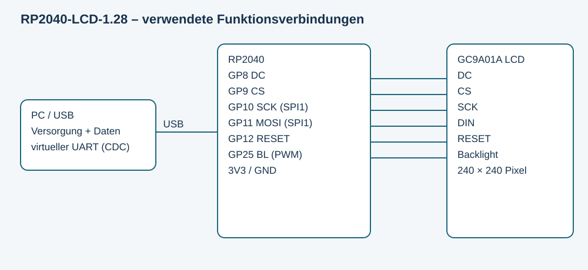
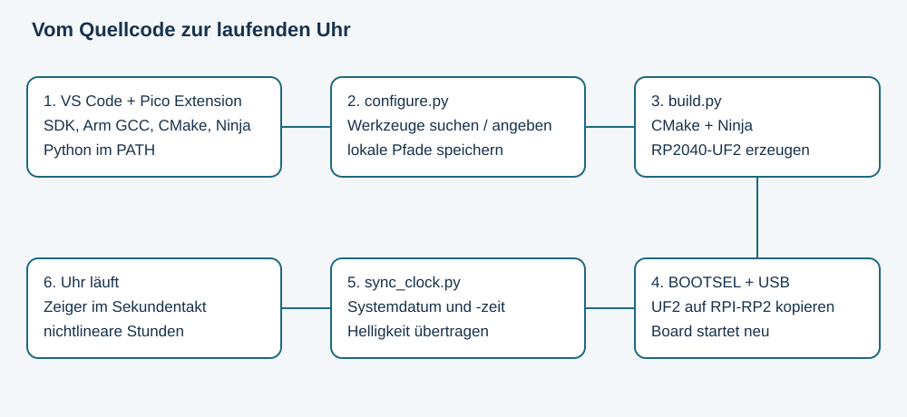

# Umsetzung

[← Gestaltung](02-gestaltung.md) · [Quellen →](04-quellen.md)

## Hardware und Schaltpläne

Getestet ist **Waveshare RP2040-LCD-1.28**, ohne Touch: RP2040, zwei Cortex-M0+-Kerne, 264 KiB SRAM, 2 MB Flash, 1,28-Zoll-Runddisplay mit GC9A01A und 240 × 240 Pixeln. USB versorgt die Platine und stellt einen virtuellen seriellen Anschluss bereit. IMU und Akkuladeschaltung werden von dieser Anwendung nicht verwendet. Keine externe Displayverdrahtung ist notwendig.

Diese eigene Zeichnung zeigt nur die verwendeten Verbindungen. Den vollständigen, zweiseitigen **Herstellerschaltplan** mit Versorgung, USB, Flash, IMU und Batterieanschluss gibt es [hier bei Waveshare](https://files.waveshare.com/upload/6/60/RP2040-LCD-1.28-sch.pdf). Die [Hersteller-Wiki](https://www.waveshare.com/wiki/RP2040-LCD-1.28) beschreibt das Board.

| Signal | GPIO |
|---|---:|
| LCD DC | GP8 |
| LCD CS | GP9 |
| SPI1 SCK | GP10 |
| SPI1 MOSI/DIN | GP11 |
| LCD RESET | GP12 |
| LCD BL/PWM | GP25 |

## Firmware

Die Firmware wurde mit Pico SDK erstellt. calendar.c enthält den gregorianischen Kalender, clock_state.c Zeitfortschreibung und Helligkeit, protocol.c den Kommandozeilenparser, clock_model.c Dichte/CDF/Winkel, clock_render.c Anzeige, lcd.c SPI/PWM und main.c den Ablauf. Die generierten C-Dateien enthalten Bitmap, Palette, Modell und Initialisierungsregister.

Der RGB565-Framebuffer belegt 115.200 Bytes. Das statische Ziffernblatt liegt im Flash; die rote Dichtekurve wird vorbereitet und als kleiner Ausschnitt zwischengespeichert. Das vollständige Bild wird einmal pro Sekunde aktualisiert. Die Anzeige erfolgt auf dem Display um 180 Grad gedreht, da das Board auf dem Kopf stehend montiert ist. 

Der Mikrosekundenzähler des RP2040 schreibt eine gesetzte lokale Basiszeit fort. Der Kalender behandelt gültige Daten einschließlich Jahrhundertregel für Jahre 1–9999. Es gibt keine automatische Sommerzeit-/Zeitzonenkorrektur und keine gepufferte externe RTC. Nach Neustart ist eine erneute Synchronisierung erforderlich, daher eignet sich die Uhr am besten für den Betrieb mit einem Akku zur Pufferung oder den Standalonebetrieb.

## Voraussetzungen

1. VS Code  + Erweiterung Raspberry Pi Pico
2. Pico SDK, Arm GNU Toolchain, CMake und Ninja bereitstellen oder vorhandene Installationen verwenden. Geprüft: SDK 2.2.0, Arm GNU 14.2.Rel1.
3. Python 3.10 oder neuer im PATH bereitstellen; python --version prüfen.
4. Dieses Repository direkt als Ordner in VS Code öffnen

Die Python-Skripte sind plattformneutral geschrieben. Konkreter Build und Tests wurden unter Windows durchgeführt; Linux/macOS wurden nicht separat geprüft.

## Konfiguration vorhandener Werkzeuge

    python tools/configure.py

Die Suche nutzt explizite Parameter, Umgebungsvariablen/PATH und übliche Verzeichnisse der Erweiterung unter .pico-sdk im Benutzerverzeichnis. Bei mehreren Installationen zusammengehörende Versionen explizit angeben:

    python tools/configure.py --sdk "C:/Pfad/pico-sdk" --toolchain "C:/Pfad/arm-toolchain" --cmake "C:/Pfad/cmake.exe" --ninja "C:/Pfad/ninja.exe"

SDK enthält pico_sdk_init.cmake; Toolchain ist der Ordner oberhalb von bin/arm-none-eabi-gcc. TinyUSB muss als SDK-Submodul vorhanden sein. Bei einem Git-SDK im SDK-Verzeichnis:

    git submodule update --init --recursive

Weitere Parameter: --tinyusb PFAD, --picotool PFAD, --pioasm PFAD, --rotation 0 oder 180. picotool/pioasm erwarten den Ordner ihrer jeweiligen *Config.cmake-Datei. 

Ergebnis ist cmake/local-tools.json mit lokalen absoluten Pfaden.  Pico SDK kann bei fehlenden Hostwerkzeugen eigene Fetch-/Buildschritte auslösen. Für Offlinebuilds picotool und pioasm vorher installieren und explizit angeben.

## Kompilieren

    python tools/build.py
    python tools/build.py --jobs 4

Alternativ unter Windows:

    powershell -NoProfile -ExecutionPolicy Bypass -File tools/configure.ps1
    powershell -NoProfile -ExecutionPolicy Bypass -File tools/build.ps1

ExecutionPolicy Bypass gilt hier nur für diesen Prozess. In VS Code: „Terminal → Run Task → Clock: configure“, dann „Clock: build“. Strg+Umschalt+B startet den Buildtask. Python muss im PATH liegen.

CMake-Cache: build/rp2040. Ergebnis: **dist/nonlinear_clock_rp2040.uf2**. Bei Wechsel von SDK/Compiler/Generator ein frisches Buildverzeichnis verwenden; den alten Ordner nur nach eigener Prüfung entfernen. Fertige Flashassets sind enthalten, daher braucht der Firmwarebuild keine Plotpakete und keine Rohdatendownloads.

## Übertragen und synchronisieren

BOOTSEL gedrückt halten und USB verbinden, dann BOOTSEL loslassen. Die UF2 auf das Laufwerk RPI-RP2 kopieren. Anschließend startet das Board mit virtuellem USB-Port neu.

Optionaler validierender Uploader:

    python tools/flash_bootsel.py --drive D:/

Den tatsächlichen Laufwerksbuchstaben einsetzen. Er prüft RP2040-Boardkennung, UF2-Familie und den 2-MB-Flashbereich. RP2350-Firmware ist für dieses Board ungeeignet.

Für den PC-Zeitabgleich:

    python -m pip install -r tools/requirements.txt
    python tools/sync_clock.py --list
    python tools/sync_clock.py --port COM3 --brightness 6

Linux-Beispielport: /dev/ttyACM0. pyserial wird nur für die USB-Skripte benötigt. Der PC überträgt lokale Systemzeit und Datum; der serielle Monitor muss den Port freigeben.

ASCII-Kommandos mit LF oder CRLF:

| Kommando | Wirkung |
|---|---|
| T:08:15:30 | Zeit im 24-h-Format |
| T:2026:10:17 | Datum, vierstellige Jahreszahl |
| B:6 | Helligkeit von 1 bis 10 |
| S | Status |
| unbekannt | Ausgabe der verfügbaren Optionen |

Beide T-Formate werden strukturell unterschieden. Ungültige Werte ändern den bestehenden Zustand nicht. Helligkeitsstufen entsprechen näherungsweise PWM=100·100^((Stufe−1)/9). 

## Tests und Asseterzeugung

Optionale Hosttests benötigen zusätzlich GCC, Clang oder Zig. Der Arm-Crosscompiler allein kann keine Hosttests ausführen.

    python tools/test.py --cc "C:/Pfad/zig.exe"
    python tools/test.py --cc "C:/Pfad/zig.exe" --previews

Nur Python-Tests:

    python -m unittest discover -s tests -p "test_*.py" -v

Für Vorschauen und Asseterzeugung zusätzlich:

    python -m pip install -r analysis/requirements.txt
    python analysis/reconstruct.py
    python tools/generate_assets.py

generate_assets.py übernimmt das  Bitmap mit dem Ziffernblatt unverändert. Bei Modelländerungen müssen Kurve, Ziffernpositionen, Bitmap und Palette geprüft und angepasst werden.
